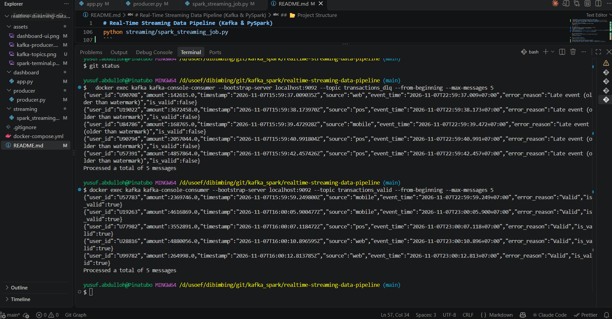

# Real-Time Streaming Data Pipeline (Kafka & PySpark)

This repository contains the end-to-end streaming data pipeline assignment project. The architecture is designed to process real-time transaction event streams using **Apache Kafka** as a message broker and **PySpark Structured Streaming** for transformation, data validation, watermarking, and Dead Letter Queue (DLQ) handling.

---

## 🏗️ Architecture & Features

1. **Event Producer (`/producer/producer.py`)**:
   - Generates random transaction events in JSON format (`user_id`, `amount`, `timestamp`, `source`) every 1–2 seconds.
   - Simulates real-world data scenarios: valid data, invalid data (negative/excessive amounts, missing fields, unknown sources), duplicates, and late events for watermarking test purposes.

2. **Stream Processing & Validation (`/streaming/spark_streaming_job.py`)**:
   - Reads events in real time from the Kafka topic `transactions` and parses them with a defined schema.
   - Implements the 5 mandatory validations and adds `is_valid` and `error_reason` columns:
     mandatory fields, type validation, amount range (1 – 10,000,000), source check, and duplicate detection (`user_id` + `timestamp`).
   - **Routing**: valid events go to `transactions_valid`; invalid events go to the Dead Letter Queue topic `transactions_dlq`.
     Events later than the 3-minute watermark are treated as invalid and also go to the DLQ.
   - **Watermark & Tumbling Window**: `withWatermark("event_time", "3 minutes")` with a 1-minute tumbling window over `transactions_valid`.
     The console output (`foreachBatch`, complete mode) shows `timestamp` and the cumulative `running_total` of valid transactions.

3. **Real-Time Monitoring Dashboard (`/dashboard/app.py`)**:
   - Built using **Streamlit** to monitor pipeline performance in real-time.

---

### Validation Rules (`error_reason`)

| error_reason | Rule |
|---|---|
| Missing user_id / amount / timestamp / source | Mandatory field check |
| Invalid timestamp format | Type validation (timestamp cannot be parsed) |
| Amount out of range | Amount must be between 1 and 10,000,000 |
| Unknown source | Source must be `mobile`, `web` or `pos` |
| Duplicate event | Same `user_id` + `timestamp` seen within the watermark period |
| Late event (older than watermark) | Event time is more than 3 minutes behind processing time |

## 📸 Preview / Screenshots

### 1. Kafka Producer Output
*Console output showing kafka producer events:*


### 2. PySpark Structured Streaming & Validation Output
*atch validation summary and window table with timestamp and cumulative running_total:*


### 3. Real-Time Streamlit Monitoring Dashboard
*Dashboard tracking total events, valid transactions, DLQ error separation, and live event logs:*


### 4. Valid & DLQ Topics
*Messages consumed from the output topics. Valid events are routed to `transactions_valid`, while invalid events (including duplicates and late events) are routed to `transactions_dlq` with an `error_reason`:*

**`transactions_valid & transactions_dlq`**


---

## 📂 Project Structure

```text
realtime-streaming-data-pipeline/
├── assets/
│   ├── dashboard-ui.png       # Screenshot of Streamlit dashboard
│   ├── kafka-producer.png     # Screenshot of kafka producer console
│   ├── kafka-topics.png       # Screenshot of messages in the DLQ & Valid topic
│   └── spark-terminal.png     # Screenshot of running PySpark console
├── dashboard/
│   └── app.py                 # Streamlit real-time monitoring dashboard
├── producer/
│   └── producer.py            # Kafka event generator
├── streaming/
│   └── spark_streaming_job.py # PySpark Structured Streaming & validation job
├── docker-compose.yml         # Docker setup for Zookeeper and Kafka
└── README.md                  # Project documentation
```

## 🚀 Getting Started & Installation
### Prerequisites
- Python 3.10+
- Java (JDK 17 or 21)
- Docker & Docker Compose
- Python packages: `pip install pyspark==3.5.0 kafka-python streamlit pandas`
  (the PySpark version must match the Kafka connector `spark-sql-kafka-0-10_2.12:3.5.0` used in the job)
- Windows only: `winutils.exe` and `hadoop.dll` (Hadoop 3.3.x) in `C:\hadoop\bin`,
  and the `HADOOP_HOME` / `JAVA_HOME` paths in `streaming/spark_streaming_job.py` adjusted to your machine

### 1. Run Kafka Infrastructure (Docker)
Start Zookeeper and Kafka in the background using Docker Compose:
```bash
docker-compose up -d
```

### 2. Kafka Topics
The streaming job creates the required topics automatically on startup
(`transactions`, `transactions_valid`, `transactions_dlq`).
To create or verify them manually:
```bash
docker exec kafka kafka-topics --create --if-not-exists --topic transactions --bootstrap-server localhost:9092 --partitions 1 --replication-factor 1
docker exec kafka kafka-topics --list --bootstrap-server localhost:9092
```

### 3. Run the Python Producer
Open a new terminal and run the producer to start sending transaction events:
```bash
python producer/producer.py
```

### 4. Run the PySpark Streaming Job
```bash
python streaming/spark_streaming_job.py
```
The console prints a summary for every micro-batch, for example:
`[batch 3] valid=5 dlq=4 {'Late event (older than watermark)': 2, 'Duplicate event': 1, ...}`
and a window table with `timestamp`, `window_start`, `window_end`, `window_total` and `running_total`.

To start from zero (for example before taking screenshots), stop the job and delete the checkpoints:
```bash
rm -rf /[c or your path]/tmp/cp_routing /[c or your path]/tmp/cp_monitor
```

### 5. Run the Monitoring Dashboard
Open another terminal to run the Streamlit dashboard:
```bash
streamlit run dashboard/app.py
```
(Access the dashboard via your browser at: http://localhost:8501).


## 📝 Submission Details
- Developed By: Yusuf
- Tools: Apache Kafka, PySpark Structured Streaming, Streamlit, Docker 