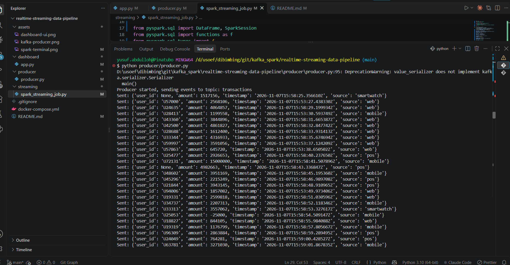
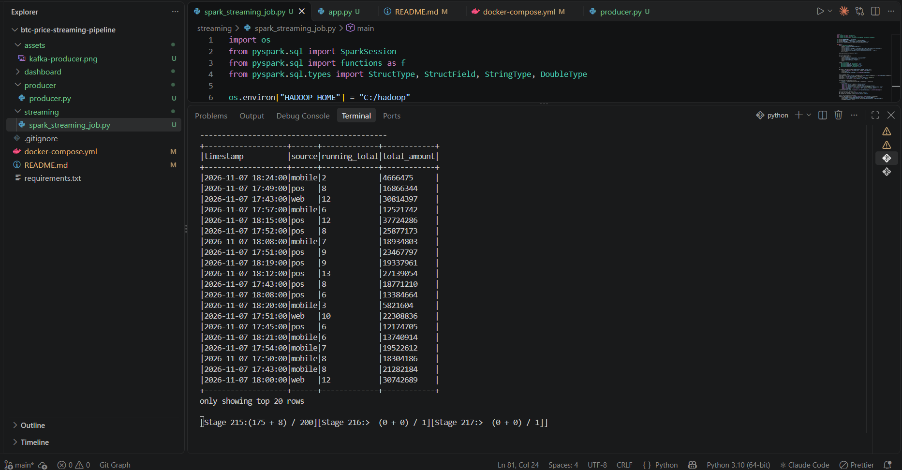
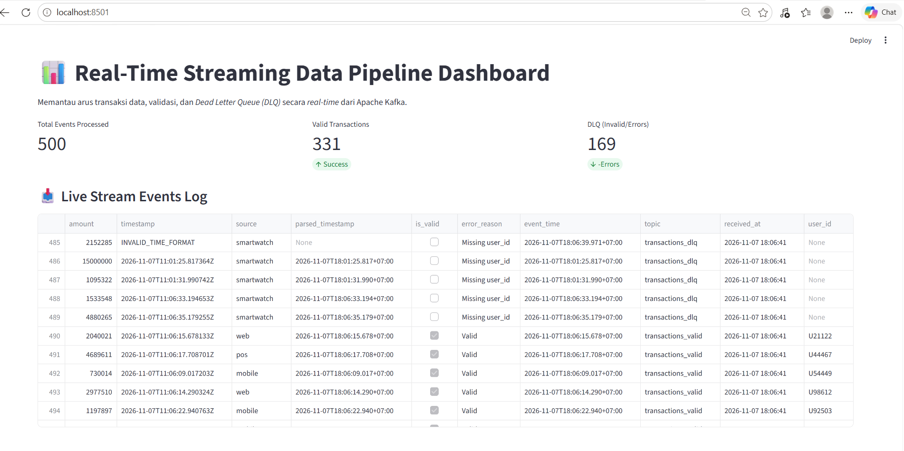

# Real-Time Streaming Data Pipeline (Kafka & PySpark)

This repository contains the end-to-end streaming data pipeline assignment project. The architecture is designed to process real-time transaction event streams using **Apache Kafka** as a message broker and **PySpark Structured Streaming** for transformation, data validation, watermarking, and Dead Letter Queue (DLQ) handling.

---

## 🏗️ Architecture & Features

1. **Event Producer (`/producer/producer.py`)**:
   - Generates random transaction events in JSON format (`user_id`, `amount`, `timestamp`, `source`) every 1–2 seconds.
   - Simulates real-world data scenarios: valid data, invalid data (negative/excessive amounts, missing fields, unknown sources), duplicates, and late events for watermarking test purposes.

2. **Stream Processing & Validation (`/streaming/spark_streaming_job.py`)**:
   - Reads data in real-time from the Kafka topic `transactions`.
   - Implements 5 Mandatory Validations (Mandatory fields, Data types, Amount range, Source check, and Duplicate detection).
   - **Routing Output**: Valid data is routed to `transactions_valid`, while errors/invalid data go to the **Dead Letter Queue (DLQ)** topic `transactions_dlq`.
   - **Watermarking & Tumbling Window**: Implements watermarking and tumbling windows for transaction running total aggregations.

3. **Real-Time Monitoring Dashboard (`/dashboard/app.py`)**:
   - Built using **Streamlit** to monitor pipeline performance in real-time.

---

## 📸 Preview / Screenshots

### 1. Kafka Producer Output
*Console output showing kafka producer events:*


### 2. PySpark Structured Streaming & Validation Output
*Console output showing real-time batch processing, windowing, and clean numeric formatting:*


### 3. Real-Time Streamlit Monitoring Dashboard
*Dashboard tracking total events, valid transactions, DLQ error separation, and live event logs:*


---

## 📂 Project Structure

```text
streaming-data-pipeline/
├── assets/
│   ├── dashboard-ui.png       # Screenshot of Streamlit dashboard
│   ├── kafka-producer.png     # Screenshot of kafka producer console
│   └── spark-terminal.png     # Screenshot of running PySpark console
├── dashboard/
│   └── app.py                 # Streamlit real-time monitoring dashboard
├── producer/
│   └── producer.py            # Kafka event generator
├── streaming/
│   └── spark_streaming_job.py # PySpark Structured Streaming & validation job
├── docker-compose.yml         # Docker setup for Zookeeper and Kafka
└── README.md                  # Project documentation
```

🚀 Getting Started & Installation
### Prerequisites
- Python 3.10+
- Java (JDK 17 or 21)
- Docker & Docker Compose

1. Run Kafka Infrastructure (Docker)
Start Zookeeper and Kafka in the background using Docker Compose:
```bash
docker-compose up -d
```

2. Create Kafka Topics
Create the necessary topics for this pipeline:
```bash
docker exec -it kafka kafka-topics --create --topic transactions --bootstrap-server localhost:9092 --partitions 1 --replication-factor 1
docker exec -it kafka kafka-topics --create --topic transactions_valid --bootstrap-server localhost:9092 --partitions 1 --replication-factor 1
docker exec -it kafka kafka-topics --create --topic transactions_dlq --bootstrap-server localhost:9092 --partitions 1 --replication-factor 1
```

3. Run the Python Producer
Open a new terminal and run the producer to start sending transaction events:
```bash
python producer/producer.py
```

4. Run the PySpark Streaming Job
Open a separate terminal to run the Spark streaming processing job:
```bash
python streaming/spark_streaming_job.py
```

5. Run the Monitoring Dashboard
Open another terminal to run the Streamlit dashboard:
```bash
streamlit run dashboard/app.py
```
Access the dashboard via your browser at: http://localhost:8501[cite: 8].


📝 Submission Details
- Developed By: Yusuf
- Tools: Apache Kafka, PySpark Structured Streaming, Streamlit, Docker 